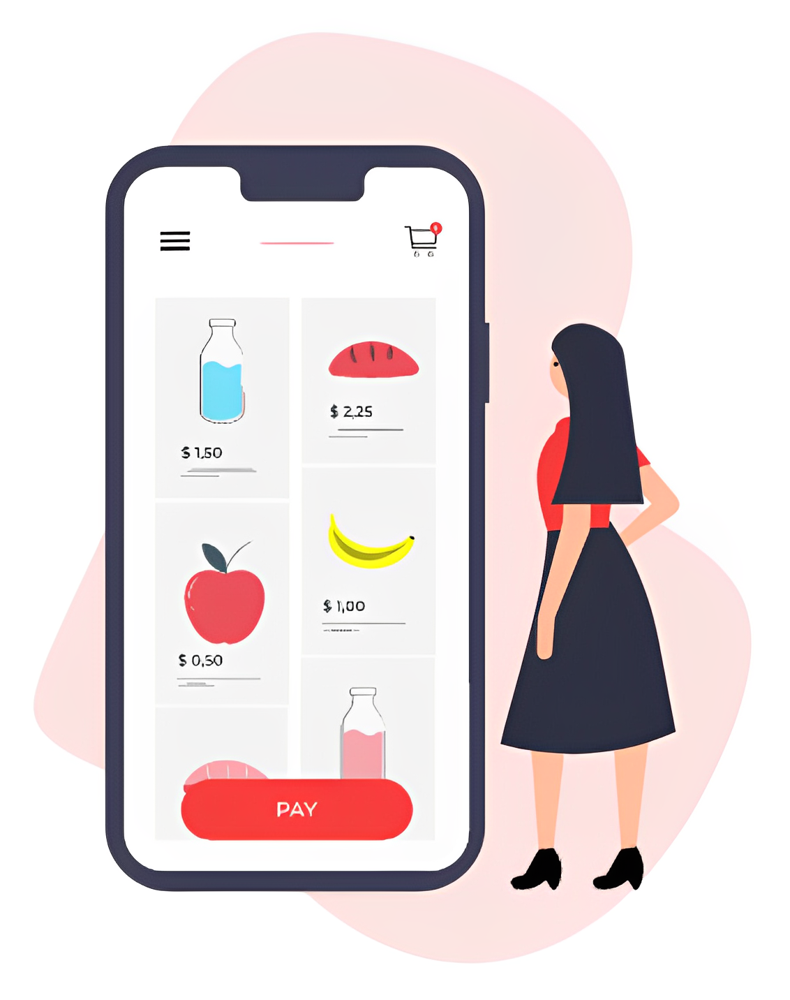

# Food Delivery App with Admin Panel

A Flutter food ordering app with a built-in admin panel. Customers browse food by category, add items to their cart and pay from an in-app wallet topped up with Stripe. Admins log in to add new food items with images.

<p>
  
  
  
</p>

Screen recordings are in the [`videos/`](videos) folder.

## Features

**Customer app**
- Onboarding, sign up, login and password reset with Firebase Auth
- Home with food categories (pizza, burger, salad, ice cream) and item details
- Cart and order screen
- Wallet top-up with the Stripe Payment Sheet
- Profile with photo upload to Firebase Storage

**Admin panel**
- Separate admin login
- Add food items with name, price, details, category and image

## Tech stack

Flutter · Dart · Firebase Auth · Cloud Firestore · Firebase Storage · Stripe (flutter_stripe) · Shared Preferences · curved_navigation_bar

## Project structure

```
lib/
  admin/      admin login, admin home, add food
  pages/      onboarding, auth, home, details, order, wallet, profile
  services/   auth, Firestore database and shared preferences helpers
  widgets/    shared widgets and constants
```

## Getting started

1. Install Flutter (3.x) and run `flutter pub get`.
2. Run `flutterfire configure` to connect your own Firebase project.
3. Run with your own Stripe **test** keys (they are read at build time, nothing is stored in the repo):

```bash
flutter run \
  --dart-define=STRIPE_PUBLISHABLE_KEY=pk_test_... \
  --dart-define=STRIPE_SECRET_KEY=sk_test_...
```

> **Note:** this is a demo project. In production the Stripe PaymentIntent must be created on a backend (for example a Cloud Function), and the secret key must never be shipped inside the app.

## License

Released under the [MIT License](LICENSE).
